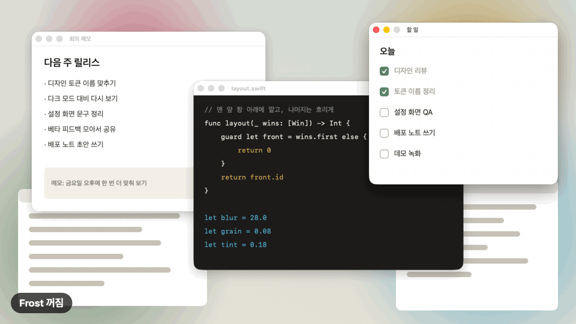
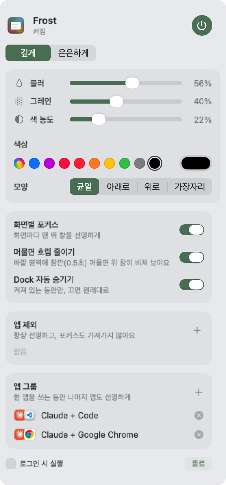
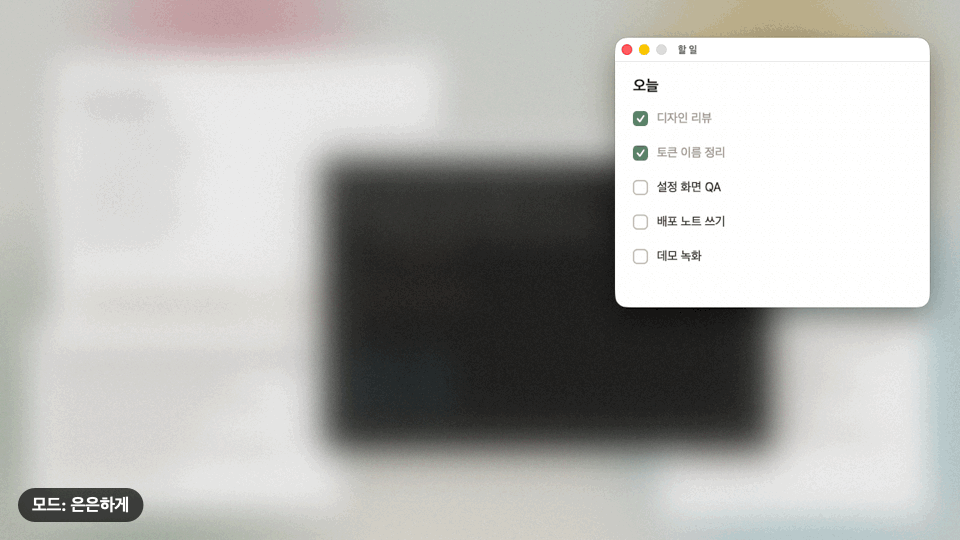
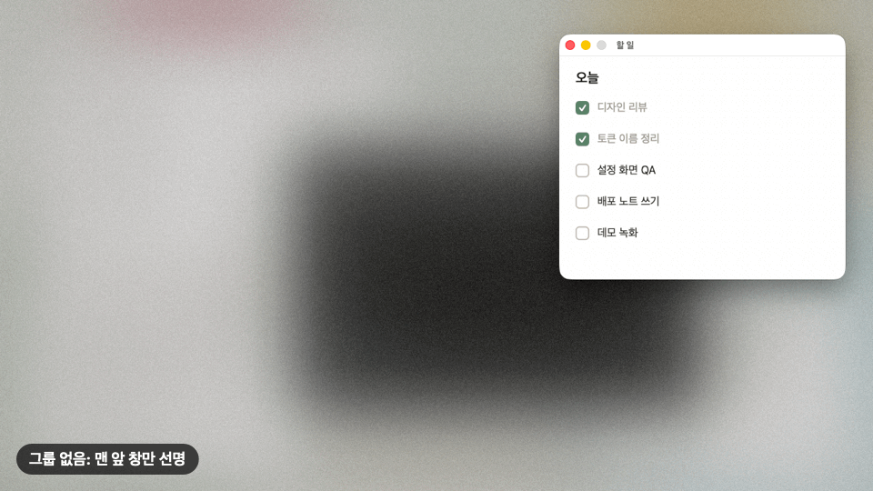

# Frost

[](https://github.com/E-JIWON/frost/actions/workflows/check.yml)

맨 앞 창 하나만 선명하게 두고, 그 뒤 화면 전체를 블러 · 색 · 그레인으로 덮는 macOS 메뉴 막대 앱.
집중할 창만 남기고 나머지는 서리 낀 유리 뒤로 보낸다.



<sub>이 문서의 GIF는 모두 실제 화면을 캡처했다. Frost는 원래 스크린샷에 안 찍혀서, 캡처에 보이게만 바꾼 복사본으로 찍었다.</sub>

- 창 단위로 동작한다. 앞 창이 바뀌면 바로 따라간다 (클릭 · 앱 전환 즉시, 키보드 전환 약 30ms)
- 블러 세기, 그레인, 색 농도, 색상, 블러 모양을 고를 수 있고 모드 두 개(깊게 · 은은하게)에 따로 저장된다
- 앱 제외, 앱 그룹, 화면별 포커스
- 스크린샷 · 화면 녹화 · Mission Control에 안 보인다
- 켜져 있는 동안 Dock을 자동으로 숨기고, 끄면 원래대로 돌려놓는다
- 가볍다: CPU 약 1%, 메모리 약 60MB ([측정 기록](docs/testing.md))
- 네트워크를 쓰지 않는다. 창의 위치와 어느 앱 창인지만 보고, 창 안의 내용은 읽지 않는다

## 설치

macOS 14 (Sonoma) 이상과 Swift 컴파일러(Xcode 15 이상 또는 Command Line Tools)가 필요하다.

```bash
xcode-select --install
```

공증(notarization)한 배포 파일이 없어서, 어느 방법이든 내 Mac에서 직접 빌드한다. 그래서 "확인되지 않은 개발자" 경고 없이 바로 열린다. 1분이면 된다.

### Homebrew로 설치 (추천)

```bash
brew install e-jiwon/tap/frost
brew trust --formula e-jiwon/tap/frost
open "$(brew --prefix)/opt/frost/Frost.app"
```

- 두 번째 줄은 한 번만 하면 된다. Homebrew 6부터 개인 tap의 앱은 믿는다고 표시해야 `brew upgrade frost` · `brew uninstall frost`처럼 짧은 이름으로 다룰 수 있다
- 업데이트: `brew upgrade frost` 뒤 패널에서 종료하고 위의 `open` 명령으로 다시 연다
- Homebrew 빌드는 업데이트할 때마다 서명이 바뀐다. 업데이트 뒤 키보드 창 전환이 늦어지면 `tccutil reset Accessibility local.frost`를 실행하고 Frost를 다시 열어 손쉬운 사용 권한을 다시 준다. **로그인 시 실행**을 쓰고 있었다면 패널에서 한 번 껐다 켠다

### 소스에서 빌드

```bash
git clone https://github.com/E-JIWON/frost.git
cd frost
./build.sh
open /Applications/Frost.app
```

`build.sh`가 하는 일:

1. `main.swift`를 컴파일한다
2. 자체 검사(`--selftest`)를 돌린다. 실패하면 설치하지 않는다
3. 서명한다. Keychain에 "Apple Development" 인증서가 있으면 그걸로, 없으면 ad-hoc 서명
4. 실행 중인 Frost를 끄고 `/Applications/Frost.app`에 설치한다

> ad-hoc 서명으로 빌드하면 다시 빌드할 때마다 macOS가 다른 앱으로 보고 손쉬운 사용 권한을 또 물어본다. 무료 Apple ID로도 Xcode에서 "Apple Development" 인증서를 만들 수 있고, 그러면 권한이 계속 유지된다.

### 처음 실행

1. 메뉴 막대에 점 무늬 속 창 모양 아이콘이 생긴다. 바로 켜진 상태로 시작한다
2. **손쉬운 사용 권한**을 물어본다. 선택 사항이다
   - 주면: 같은 앱 안에서 키보드로 창을 바꿀 때(⌘\`, ⌘N) 바로 따라간다 (약 30ms)
   - 안 주면: 0.1초마다 확인해서 따라간다 (평균 약 65ms). 나머지는 똑같다
   - 나중에 주려면: 시스템 설정 → 개인정보 보호 및 보안 → 손쉬운 사용 → Frost 켜기. 다시 실행할 필요 없이 다른 앱으로 한 번 전환하면 적용된다
3. Dock이 자동 숨김으로 바뀐다. 원치 않으면 패널에서 끈다

## 사용법

아이콘을 클릭하면 패널이 열린다. 포인터가 패널 밖으로 나가 0.6초 지나면 저절로 닫힌다.
설정은 바로 적용되고 저장된다.



### 맨 위

| 항목 | 설명 |
|---|---|
| 전원 버튼 | Frost 켜기 · 끄기. 끄면 흐림이 사라지고 Dock 설정도 원래대로 돌아간다 |
| 깊게 / 은은하게 | 모드 두 개. 아래의 블러 · 그레인 · 색 농도 · 색상 · 모양이 모드마다 따로 저장된다. 집중할 때는 깊게, 평소에는 은은하게 같은 식으로 쓴다 |

### 모양

| 항목 | 설명 |
|---|---|
| 블러 | 뒤 화면이 흐려지는 정도 |
| 그레인 | 필름 같은 입자감 |
| 색 농도 | 고른 색을 얼마나 진하게 덮을지 |
| 색상 | 잉크 · 세이지 · 스카이 · 샌드 · 민트 · 핑크 6가지, 오른쪽 칸을 누르면 아무 색이나 고를 수 있다 |
| 모양 | 블러가 깔리는 모양. **균일**(전체 같은 세기), **아래로**(아래로 갈수록 진하게), **위로**(위로 갈수록 진하게), **가장자리**(가운데는 옅고 가장자리로 갈수록 진하게) |



### 동작

| 항목 | 기본값 | 설명 |
|---|---|---|
| 화면별 포커스 | 켜짐 | 켜면 모니터마다 그 화면의 맨 위 창이 선명하다. 끄면 모든 모니터를 통틀어 맨 앞 창 하나만 선명하다 |
| 머물면 흐림 줄이기 | 켜짐 | 흐린 곳에 포인터를 0.5초 올려두면 흐림이 옅어져 뒤 창이 비쳐 보인다. 다른 창으로 옮기기 전에 위치를 확인할 때 좋다. 선명한 창으로 포인터를 옮기면 바로 돌아온다 |
| Dock 자동 숨기기 | 켜짐 | Frost가 켜져 있는 동안만 Dock을 숨긴다. 화면 아래로 포인터를 가져가면 Dock이 나온다. 끄거나 Frost를 종료하면 원래 설정으로 돌아간다 |

### 앱 제외

`+`를 눌러 실행 중인 앱에서 고른다. 제외한 앱의 창은 **항상 선명**하고, 맨 앞에 와도 **포커스를 가져가지 않는다**.
음악 앱이나 메신저처럼 옆에 띄워두고 계속 보고 싶은 앱에 쓴다. `ⓧ`로 뺀다.

### 앱 그룹

같이 쓰는 앱을 묶는다. 그룹 안 한 앱을 쓰는 동안 **같은 그룹의 다른 앱은 맨 위 창 하나가 선명**하게 남는다.

- 기본 그룹: Claude + Visual Studio Code, Claude + Google Chrome
- `+` → 함께 쓸 앱 2개 이상 체크 → 그룹 만들기
- 같은 앱 창끼리는 적용되지 않는다. 크롬 창 두 개를 띄워도 앞에 있는 크롬 창만 선명하다



### 맨 아래

- **로그인 시 실행**: Mac을 켜면 Frost도 같이 켜진다
- **종료**: Frost를 끈다. Dock 설정을 원래대로 돌려놓고 끝난다

## 이렇게 동작한다

- **창 단위**: 앱이 아니라 창을 본다. 크롬에서 새 창을 열면 새 창이 선명해지고 원래 크롬 창은 흐려진다
- **얼마나 빨리 따라가나**
  - 클릭, 앱 전환(⌘Tab), 창 끌기: 즉시
  - 같은 앱 안의 키보드 전환(⌘\`, ⌘N): 손쉬운 사용 권한이 있으면 평균 약 30ms, 없으면 약 65ms
  - 뒤에서 다른 앱 창이 튀어나올 때: 평균 약 60ms (0.1초마다 확인)
- **건드리지 않는 것**: 메뉴, 확장 프로그램 팝업, 속 화면 보기(PIP)처럼 일반 창보다 위에 뜨는 것, 50pt보다 작은 창
- **스크린샷 · 화면 녹화**: Frost는 안 찍힌다. 캡처하면 흐리지 않은 원래 화면이 나온다. 스크린샷을 찍기 시작해도 앞 창이 흐려지지 않는다
- **Mission Control**: Frost가 보이지 않는다
- **전체 화면 앱**: 앱이 화면을 다 채우니 그 화면의 Frost는 숨는다
- **모니터를 꽂거나 뺄 때**: 자동으로 화면 수에 맞춘다

## 문제 해결

| 증상 | 해결 |
|---|---|
| 키보드로 창을 바꾸면 살짝 늦게 따라온다 | 손쉬운 사용 권한을 준다 (처음 실행 2번 참고) |
| Frost가 강제 종료된 뒤 Dock이 계속 숨겨져 있다 | Frost를 다시 실행했다가 패널의 종료로 끈다. 정상 종료나 `kill`로 끄면 자동으로 돌아오지만, 강제 종료(`kill -9`)는 어떤 앱도 정리할 틈이 없다 |
| 빌드할 때 `swiftc: command not found` | `xcode-select --install` |
| 다시 빌드할 때마다 권한을 또 물어본다 | ad-hoc 서명이라서 그렇다. 설치 섹션의 인증서 안내 참고 |
| 블러가 안 보이고 색만 덮인다 | macOS가 블러에 쓰는 비공개 기능을 바꾼 경우다. 이때도 앱은 켜지고 색 · 그레인은 동작한다. 이슈로 알려주면 좋다 |

## 지우기

1. 패널에서 **로그인 시 실행**을 끄고 **종료**를 누른다 (Dock이 원래대로 돌아온다)
2. 지운다

   ```bash
   brew uninstall frost                    # Homebrew로 설치했다면
   rm -rf /Applications/Frost.app          # 소스로 설치했다면 (또는 Finder에서 휴지통으로)
   defaults delete local.frost             # 설정
   tccutil reset Accessibility local.frost # 손쉬운 사용 목록에서 빼기
   ```

## 만든 방식

개발자용 메모.

- **파일**: `main.swift` 하나에 앱 전체가 있다. `build.sh`는 빌드 · 검사 · 설치, `icon.swift`는 `AppIcon.icns`를 코드로 그린다 (없을 때만 `build.sh`가 실행)
- **화면을 덮는 법**: 화면마다 클릭이 통과하는 창을 하나씩 띄우고, 맨 앞 창 바로 아래에 둔다. 창 안의 `CABackdropLayer`가 그 뒤를 블러하고, 그 위에 색과 그레인을 얹는다. 블러 모양은 `variableBlur` 필터의 세기 마스크로 만든다. 제외 · 그룹 창은 마스크에 구멍을 뚫어 선명하게 남긴다
- **앞 창 찾기**: `CGWindowListCopyWindowInfo`로 창 목록을 앞에서부터 읽는다 (호출당 약 0.6ms). 앱 전환 · Space 변경 · 마우스 클릭/드래그 이벤트에 바로 반응하고, 손쉬운 사용 권한이 있으면 맨 앞 앱의 창 포커스 변화(AXObserver)도 받는다. 이벤트로 알 수 없는 변화는 0.1초 확인으로 잡는다
- **비공개 API**: `CABackdropLayer`, `CAFilter`(variableBlur), `CoreDockGet/SetAutoHideEnabled`. 그래서 App Store에는 낼 수 없다. 모두 실행 중에 찾아 쓰기 때문에, macOS가 하나를 없애도 앱이 안 켜지는 대신 그 기능만 빠진다
- **검사**: `Frost.app/Contents/MacOS/Frost --selftest`가 포커스 · 제외 · 그룹 · 화면별 포커스 · 전체 화면 규칙을 17개 항목으로 확인한다. `build.sh`와 깃헙 Actions가 매번 돌린다. 반응 속도 측정(`bench/run.sh`)과 직접 확인한 목록은 [docs/testing.md](docs/testing.md)에 있다
- **컴파일**: Swift 6 언어 모드, 엄격한 동시성 검사에서도 경고 0개
- **설정 저장 위치**: `defaults read local.frost`
- 화면 문구는 한국어만 있다
